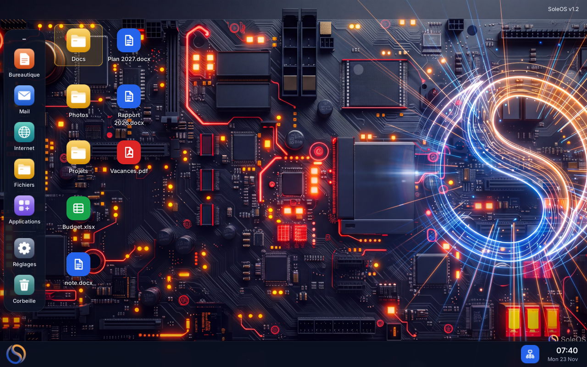
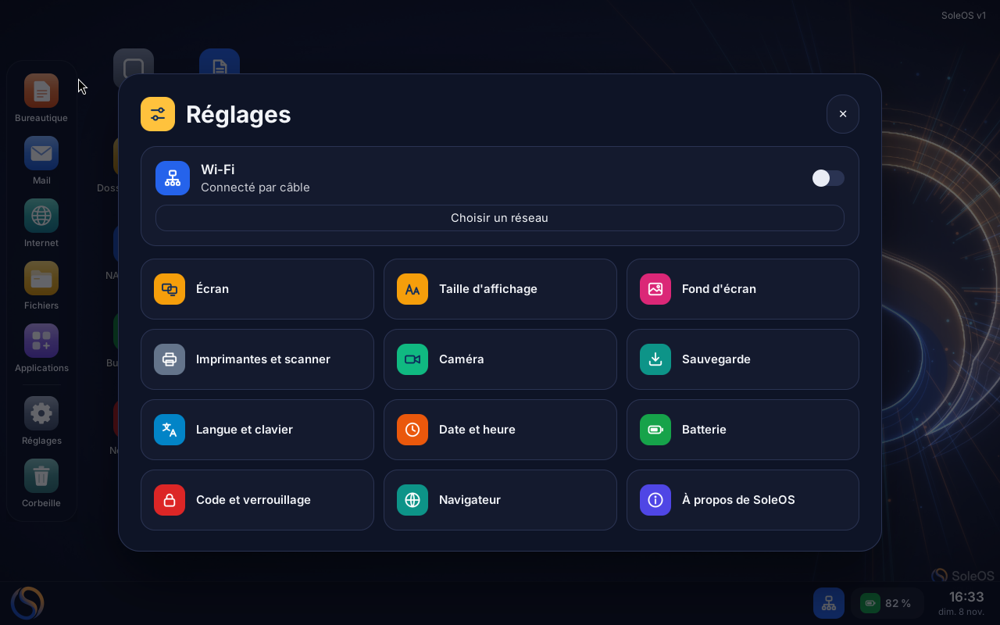
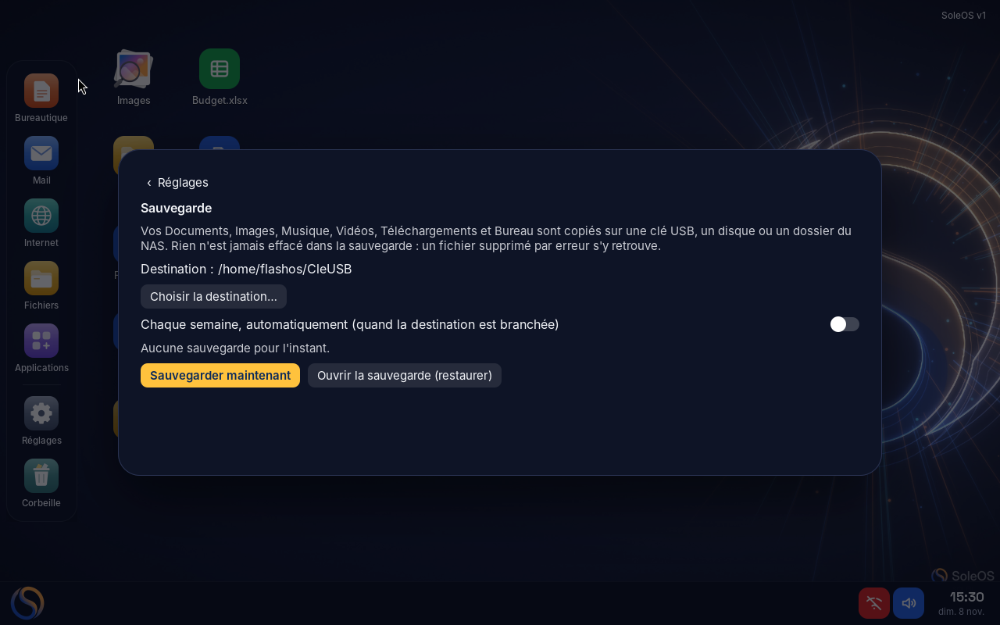

<p align="center"></p>

<p align="right"><a href="README.fr.md">Version française</a></p>

# SoleOS

**A simple, fast and secure computer: no account, no ads, no telemetry.**
SoleOS is an operating system based on Debian 13, with an interface written in Rust/GTK 4.
It is made for people who want a computer that just works, with no administration.

**Download**: the latest version (an ISO to copy to a USB stick) is in [Releases](https://github.com/SoleOS-project/SoleOS/releases/latest).

## What SoleOS does

- **Easy**: an app bar on the left, an “S” menu at the bottom left, settings shown as large cards. Three questions at first start, and you are ready.
- **Your files are encrypted**: a 6-digit code (TPM chip) or a password, plus a recovery key on paper.
- **Invisible updates**: prepared on a second copy of the system, applied at restart, with automatic rollback if something goes wrong.
- **New versions without reinstalling** (since v1.2): start from the USB stick of the new version and choose “Update SoleOS”; files, apps, emails, browser, settings and code are all kept.
- **One-click backup** to a USB stick, a disk or a NAS, every week if you like. Nothing is ever deleted from the backup.
- **Notifications**: new emails shown by an envelope in the bottom bar.
- **Comfort mode**: larger text and a highly visible pointer.
- **Built-in repair**: the system is restored as new while your files are kept (Settings → Repair or reset).
- **Privacy**: no account, no telemetry, nothing is sent without your consent; browser without ads or trackers, third-party cookies blocked.
- **Apps**: LibreOffice, Thunderbird, Chromium, VLC, KeePassXC, and the Flathub catalogue; `.deb` packages and AppImages accepted in a separate space.
- **6 languages**: French, English, Italian, Spanish, German, Simplified Chinese.

<p align="center">
 
</p>

## Documentation

- [User guide (PDF, French)](docs/SoleOS-v1-guide-utilisation.pdf)
- [Technical sheet (PDF, French)](docs/SoleOS-v1-fiche-technique.pdf)

## Recommended hardware

x86-64 processor (Intel, AMD), 4 GB of memory (8 GB recommended), 32 GB of disk (SSD recommended), UEFI (Secure Boot supported) or BIOS, TPM 2.0 chip recommended. Very recent PC: a recent kernel is offered when starting from the USB stick (Esc) and in Settings → About.

## Building the ISO image

On a Debian 13 (amd64) machine, as root, with the whole content of this repository in one folder:

```sh
bash construire-iso-soleos.sh
```

Result: `SoleOS-v1.2.iso` and its checksum `SoleOS-v1.2.iso.sha256`. Copy the ISO to a USB stick (for example with `dd` or balenaEtcher) and start from it: the stick opens in try mode, then offers **Install SoleOS on this computer** (or **Update SoleOS** if it is already installed).

Rebuilding the interface (optional, compiled programs are included):

```sh
cd source/soleos-accueil && cargo build --release
```

> The source code, comments and file names are in French, the project's working language.

## Repository content

| Folder / file | Purpose |
|---|---|
| `construire-iso-soleos.sh` | ISO build script |
| `soleos-accueil`, `soleos-applications`, `soleos-installateur`, `soleos-bluetooth` | compiled interface (Rust) |
| `soleos-installer`, `soleos-systeme`, `soleos-securite` | system tools (bash): installation, A/B updates, encryption |
| `source/` | source code of the interface and tools |
| `locale/`, `po/` | translations (6 languages) |
| `fonds/`, `polices/`, `craft/` | wallpapers, fonts, icons |
| `outils/` | logo, system files, utilities |
| `docs/` | guide, technical sheet, screenshots, test reports |
| `chuwi-son/` | Chuwi CoreBook Air Plus speakers: [Chuwi-CoreBook-Air-Audio-Fix](https://github.com/avrora13377/Chuwi-CoreBook-Air-Audio-Fix) (MIT licence, thanks to its authors) |

## Reporting a problem

In SoleOS: **S** menu → **Report a problem** (a message is prepared with a technical report, without any password).
Or open an *issue* on this repository, describing the computer (brand, model) and the problem.

## Licence

**SoleOS is free, but not for making money with it.**

- ✅ **Free** for individuals, non-profit associations (including when they sell refurbished computers), schools, public administrations, and internal use in companies.
- 💼 **Commercial use** (selling computers with SoleOS, paid services, integration into a product…): a licence is required. Contact: **gdarco7@gmail.com**

Licence: [PolyForm Noncommercial 1.0.0](https://polyformproject.org/licenses/noncommercial/1.0.0/) with additional permissions, see [LICENSE](LICENSE).
SoleOS is provided “as is”, without warranty. Included third-party software (Debian, LibreOffice, Chromium…) keeps its own licences.

© 2026 GDH — created by Giuseppe D'Arco.
