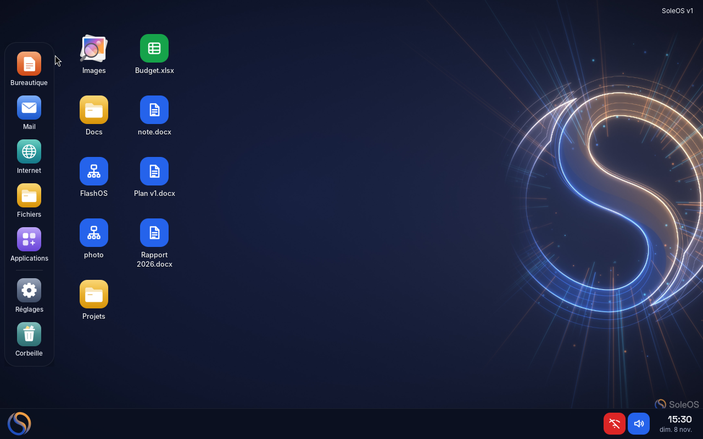
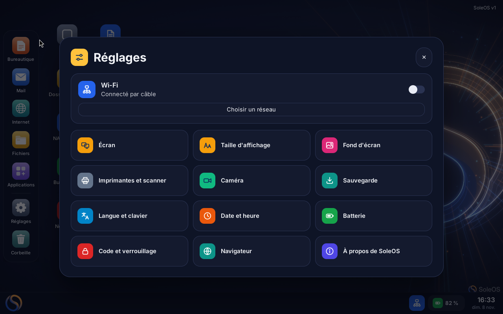
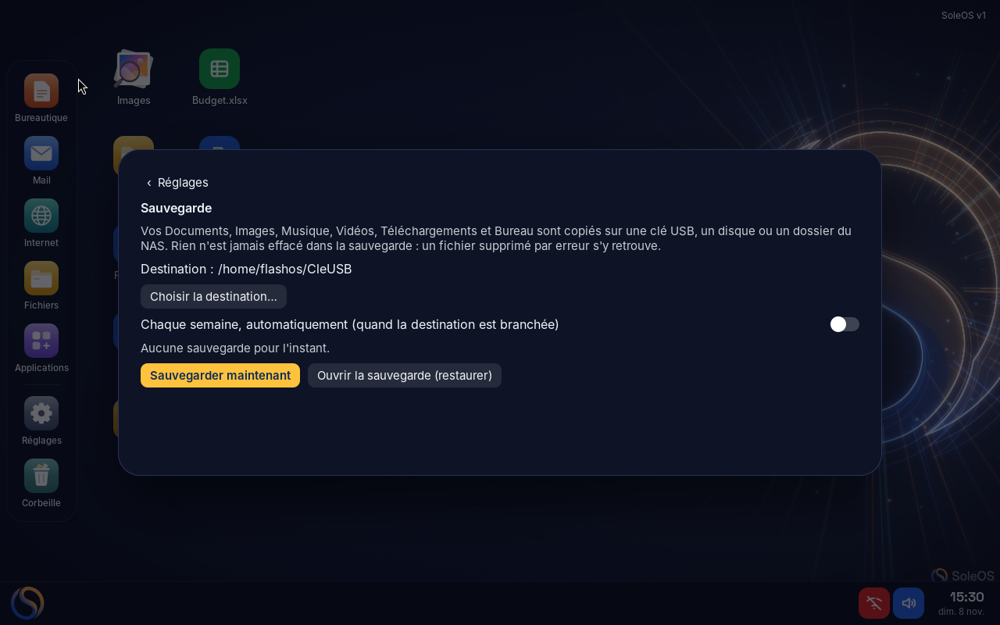

<p align="center"></p>

# SoleOS

**Un ordinateur simple, rapide et sûr, sans compte, sans publicité, sans télémétrie.**
SoleOS est un système d'exploitation basé sur Debian 13, avec une interface écrite en Rust/GTK 4.
Il est pensé pour les gens qui veulent un ordinateur qui marche, sans administration.

*A simple, fast and private operating system based on Debian 13. Available in French, English, Italian, Spanish, German and Chinese.*

## Ce que fait SoleOS

- **Facile** : une barre d'applications à gauche, un menu « S » en bas à gauche, des réglages en grandes cartes. Trois questions au premier démarrage, et c'est prêt.
- **Vos fichiers sont chiffrés** : un code à 6 chiffres (puce TPM) ou un mot de passe, et une clé de secours sur papier.
- **Mises à jour invisibles** : préparées sur une deuxième copie du système, appliquées au redémarrage, avec retour automatique en arrière en cas de problème.
- **Sauvegarde en un clic** vers une clé USB, un disque ou un NAS, chaque semaine si vous le voulez. Rien n'est jamais effacé dans la sauvegarde.
- **Mode grand confort** : textes plus grands et pointeur bien visible.
- **Réparation intégrée** : remise à neuf du système en gardant vos fichiers (Réglages → Réparer ou réinitialiser).
- **Vie privée** : aucun compte, aucune télémétrie, rien n'est envoyé sans votre accord.
- **Applications** : LibreOffice, Thunderbird, Chromium, VLC, KeePassXC, et la logithèque Flathub ; paquets `.deb` et AppImage acceptés dans un espace séparé.
- **6 langues** : français, anglais, italien, espagnol, allemand, chinois simplifié.

<p align="center">
 
</p>

## Documentation

- [Guide d'utilisation (PDF)](docs/SoleOS-v1-guide-utilisation.pdf)
- [Fiche technique (PDF)](docs/SoleOS-v1-fiche-technique.pdf)

## Configuration conseillée

Processeur x86-64 (Intel, AMD), 4 Go de mémoire (8 Go conseillés), 32 Go de disque (SSD conseillé), UEFI (Secure Boot accepté) ou BIOS, puce TPM 2.0 conseillée.

## Fabriquer l'image ISO

Sur une machine Debian 13 (amd64), en root, avec tout le contenu de ce dépôt dans un même dossier :

```sh
bash construire-iso-flashos.sh
```

Résultat : `SoleOS-v1.0.3.iso` et son empreinte `SoleOS-v1.0.3.iso.sha256`. Copiez l'ISO sur une clé USB (par exemple avec `dd` ou Balena Etcher), démarrez dessus : la clé s'ouvre en mode essai, puis propose **Installer SoleOS sur cet ordinateur**.

Recompiler l'interface (facultatif, les programmes compilés sont fournis) :

```sh
cd source/flashos-accueil && cargo build --release
```

> Les noms techniques internes (`flashos-*`, étiquettes de partitions, `ID=flashos`) viennent du nom de travail du projet. Ils sont gardés pour la compatibilité des mises à jour et de la réparation.

## Contenu du dépôt

| Dossier / fichier | Rôle |
|---|---|
| `construire-iso-flashos.sh` | construction de l'ISO |
| `flashos-accueil`, `flashos-applications`, `flashos-installateur`, `flashos-bluetooth` | interface compilée (Rust) |
| `flashos-installer`, `flashos-systeme`, `flashos-securite` | outils système (bash) : installation, mises à jour A/B, chiffrement |
| `source/` | code source de l'interface et des outils |
| `locale/`, `po/` | traductions (6 langues) |
| `fonds/`, `polices/`, `craft/` | fonds d'écran, polices, icônes |
| `outils/` | logo, fichiers système, utilitaires |
| `docs/` | guide, fiche technique, captures |

## Signaler un problème

Dans SoleOS : menu **S** → **Signaler un problème** (un message est préparé avec un relevé technique, sans aucun mot de passe).
Ou ouvrez une *issue* sur ce dépôt en décrivant l'ordinateur (marque, modèle) et le problème.

## Licence

**SoleOS est gratuit, mais pas pour faire de l'argent avec.**

- ✅ **Gratuit** pour les particuliers, les associations sans but lucratif (y compris lorsqu'elles revendent des ordinateurs reconditionnés), les écoles, les administrations, et l'usage interne des entreprises.
- 💼 **Usage commercial** (vente d'ordinateurs équipés de SoleOS, service payant, intégration dans un produit…) : une licence est nécessaire. Contact : **gdarco7@gmail.com**

Licence : [PolyForm Noncommercial 1.0.0](https://polyformproject.org/licenses/noncommercial/1.0.0/) avec autorisations supplémentaires, voir [LICENSE](LICENSE).
SoleOS est fourni « tel quel », sans garantie. Les logiciels tiers inclus (Debian, LibreOffice, Chromium…) gardent leurs propres licences.

© 2026 GDH — créé par Giuseppe D'Arco.
